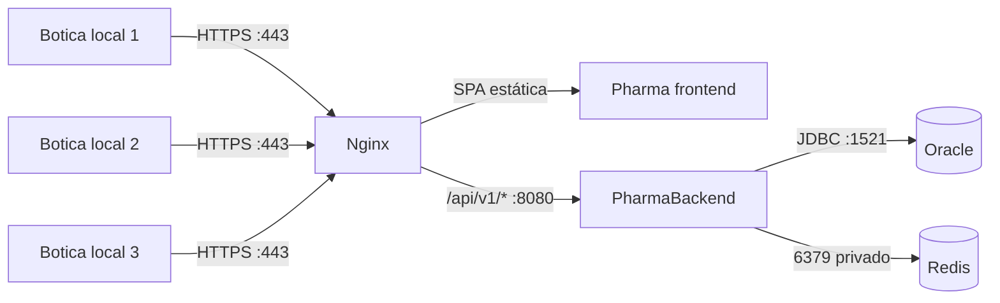

# PharmaBackend sysventas

API REST de PharmaSoft construida con Spring Boot, Oracle, Redis y autenticación JWT.

## Desarrollo local

Requisitos: JDK 21, Oracle Free en `localhost:1522/FREEPDB1`, Redis en `localhost:6379` y un cliente Angular en `localhost:4200` o el Nginx de desarrollo en `localhost:8081`.

```powershell
.\mvnw.cmd spring-boot:run
```

El perfil local `dev` es el predeterminado. Flyway aplica las migraciones y Spring Security protege los endpoints de negocio. Swagger está disponible en `http://localhost:8080/swagger-ui.html`. La verificación de disponibilidad pública responde en `http://localhost:8080/actuator/health`; las métricas requieren un JWT con permiso de administración.

## Despliegue en producción

Las tres boticas consumen una instalación centralizada. Nginx termina HTTPS y sirve Angular; las peticiones `/api/` pasan al backend. Oracle y Redis solo son accesibles desde la red privada de aplicaciones.



En desarrollo, Oracle usa `1522/FREEPDB1`; en producción, `DB_URL` define el host, puerto y servicio reales (Oracle suele usar `1521`). Redis usa `6379` por defecto. No expongas puertos de base de datos o caché a Internet.

### Variables de entorno

Define los valores con el gestor de secretos del servidor. No guardes valores reales en YAML, README ni en Git.

| Variable | Propósito |
|---|---|
| `SPRING_PROFILES_ACTIVE` | Debe ser `prod` en producción; activa validación de esquema y logs de producción. |
| `SERVER_PORT` | Puerto HTTP interno; por defecto, `8080`. |
| `DB_URL` | URL JDBC de Oracle. |
| `DB_USERNAME` / `DB_PASSWORD` | Usuario y contraseña del esquema. |
| `REDIS_HOST` / `REDIS_PORT` | Host y puerto del Redis privado; el puerto predeterminado es `6379`. |
| `JWT_SECRET` | Clave HMAC codificada en Base64, de al menos 256 bits. |
| `JWT_EXPIRACION_MINUTOS` | Tiempo de validez del token; por defecto, `60`. |
| `FRONTEND_ORIGINS` | Lista separada por comas de orígenes exactos autorizados por CORS. |

`spring.cache.redis.time-to-live` está configurado por defecto a 10 minutos. Las claves de categorías y productos se invalidan al cambiar los datos correspondientes. Si Redis no está disponible, el `CacheErrorHandler` registra el tipo de error sin incluir claves ni mensajes de conexión y deja continuar la lectura contra Oracle.

### Construcción y publicación

1. Preparar una versión y respaldar Oracle; comprobar que el script de migración sea compatible con la versión actual.
2. Construir el artefacto desde este repositorio: `.\mvnw.cmd clean package -DskipTests`.
3. Configurar `SPRING_PROFILES_ACTIVE=prod` y todas las variables. Iniciar el JAR como servicio administrado o contenedor privado; no publicar Oracle ni Redis.
4. Publicar el build de Angular en Nginx, habilitar TLS y configurar el proxy `/api/` hacia este servicio en `SERVER_PORT`.
5. Verificar `/actuator/health`, consultar ventas con un usuario de prueba y revisar que `X-Request-Id` aparezca en la respuesta y en los logs.

### Reversión

Conserva el JAR anterior y el build Angular anterior con sus archivos versionados. Si falla la verificación, vuelve a la versión previa del backend y apunta Nginx al build anterior. Las migraciones de Oracle deben poder coexistir durante la reversión; si no son compatibles, aplica primero el procedimiento de restauración validado y deja constancia del punto de recuperación.

### Estado de prácticas

| Práctica | Estado | Acción pendiente |
|---|---|---|
| Redis con TTL, estadísticas y evicción en escrituras | Cumple en código | Medir aciertos, tiempos y los seis casos de invalidación en el ambiente. |
| Continuidad de lecturas si Redis falla | Cumple en código | Capturar resultado de lectura y health durante la interrupción controlada. |
| Request ID en cabecera, logs y cuerpo de errores | Cumple en código | Capturar una venta y reconstruir todas sus líneas por ID. |
| Actuator health público y métricas bajo permiso ADMIN | Cumple en código | Capturar health con Redis arriba/abajo y métricas de ventas. |
| Secretos y DNI fuera de logs de producción | Cumple en código tras retirar campos sensibles | Revisar `logs/pharma-backend.log` del entorno real antes de cada entrega. |
| Perfil prod sin credenciales en el repositorio | Cumple parcialmente | Proveer valores con gestor de secretos y documentar rotación. |
| HTTPS, respaldos y alertas | Pendiente de infraestructura | Implementar TLS, probar restauraciones Oracle y crear alertas de disponibilidad. |

### Recomendaciones para los tres locales

1. **Prioridad alta:** centralizar la API sobre HTTPS y restringir Oracle/Redis a la red de backend.
2. **Prioridad alta:** automatizar respaldos consistentes de Oracle con prueba de restauración y responsable de recuperación.
3. **Prioridad media:** crear alertas para health, Redis, tasa de errores y latencia de `POST /api/v1/ventas`.
